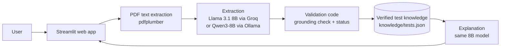
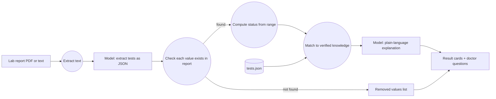
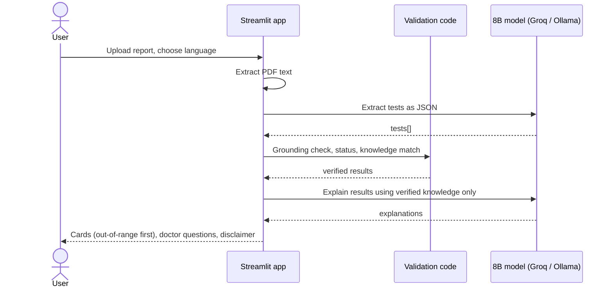

# ReportSamjho

**Understand your lab report in simple Urdu or English.** Upload a lab report PDF and see which values are outside the normal range, what each test measures, and what to ask your doctor.

Built for Hacktoberfest Islamabad 2026 · Domain: **Health & Wellness**

> ReportSamjho explains reports. It does not diagnose and does not replace a doctor.

## Problem

People in Pakistan receive lab reports (CBC, sugar, lipid profile, liver and kidney tests, urine R/E) full of abbreviations like HbA1c, SGPT or TLC. Most patients, and the family members who manage an elderly parent's health, cannot tell which values matter or what they mean. They search online, get confusing or alarming answers, or wait days for a doctor's appointment just to understand the report.

**Target users:** patients and their families, especially people more comfortable in Urdu than in medical English.

## Solution

ReportSamjho reads the report and, for every test:

- shows the value, the normal range printed on the report, and whether it is within, above, or below that range;
- explains what the test measures and what out-of-range values are generally linked to, in English, Urdu, or Roman Urdu;
- lists questions to ask the doctor about the values that need attention;
- shows a clear "see a doctor soon" note when a value is far outside its range.

**Core features**

- PDF upload, or paste the report text
- Values outside the range shown first
- Explanations in English, Urdu (right-to-left), or Roman Urdu
- Runs on Groq's cloud API, or fully offline with Ollama so medical data never leaves the device

## AI component

| Item | Detail |
|---|---|
| Default model | **Llama 3.1 8B Instant** (`llama-3.1-8b-instant`), 8 billion parameters, open-weight (Meta Llama 3.1 Community License) |
| Default provider | **Groq API** (OpenAI-compatible endpoint) |
| Local option | **Qwen3-8B** (`qwen3:8b`), 8 billion parameters, Apache-2.0, via **Ollama** |
| Max model size used | 8B, within the event limit |

**What the model does (two calls per report):**

1. **Extraction.** Reads the raw report text and returns structured JSON for every test: section/panel, test name, value, unit, and reference range. This replaces hand-written parsers, which break on every lab's different layout.
2. **Explanation.** Rewrites a verified knowledge entry for each test into 2–3 calm, plain sentences in the chosen language, tailored to the patient's actual result.

**Why the AI is essential:** without the model, the app cannot read reports from different labs or explain them in Urdu. Removing it removes the product.

**How we keep the AI honest (original engineering in this repo):**

- **Grounding check.** Every value the model extracts must appear in the report text. Values that don't are removed and listed under "How we checked these results".
- **Code decides the status, not the model.** Whether a value is low, normal, or high is computed by plain code from the extracted range (`compute_status`).
- **Verified knowledge only.** Explanations come from `knowledge/tests.json`, 39 common tests written in plain words and checked against MedlinePlus. The model may only rephrase these facts. Tests not in the list show "No verified explanation, please ask your doctor" instead of a guess.
- **Panel-aware matching.** The same name can mean different things. `pH` under *Urine R/E* is explained as urine pH; `pH` under any other section (e.g. blood gases) is not explained at all, because blood pH has a completely different meaning.
- **Temperature 0** and JSON output mode for repeatable results.

## Architecture



## Data flow



No database is used and nothing is stored: the report lives only in the user's session, so no ER diagram applies.

## Sequence



## Setup

**Requirements:** Python 3.10+, and either a free Groq API key or Ollama installed.

```bash
git clone https://github.com/<your-username>/reportsamjho.git
cd reportsamjho
python -m venv .venv
source .venv/bin/activate        # Windows: .venv\Scripts\activate
pip install -r requirements.txt
cp .env.example .env             # Windows: copy .env.example .env
```

Edit `.env`:

| Variable | Meaning |
|---|---|
| `LLM_PROVIDER` | `groq` (default) or `ollama` |
| `GROQ_API_KEY` | Your key from console.groq.com (Groq only) |
| `LLM_MODEL` | Optional. Defaults: `llama-3.1-8b-instant` (Groq), `qwen3:8b` (Ollama) |

**Fully local option:** install Ollama, run `ollama pull qwen3:8b`, and set `LLM_PROVIDER=ollama`.

**Run:**

```bash
streamlit run app.py
```

**Minimal usage example:** tick "Use the sample report", choose Urdu, click **Explain my report**. Haemoglobin, MCV, cholesterol, HDL, ALT, vitamin D and urine pus cells appear first as out-of-range; urine pH 7.0 shows as within range with a urine-specific explanation; C-Reactive Protein shows the "no verified explanation" message.

**Run the tests (no API key needed):**

```bash
pytest -q
```

## Testing and findings

All test data is synthetic (`samples/sample_report.pdf`, made by `scripts/make_sample_report.py`). No real patient data is in this repository.

**Automated tests** (`tests/`, run with `pytest`, no network):

| Scenario | Input | Expected | Actual | Result |
|---|---|---|---|---|
| Status logic | 10.8 with range 12–16; 236 with "< 200"; "8-10" with 0–5 | low; high; far above | same | ✅ Pass |
| Grounding | Model output containing an invented "Fake Test 99.9" | Row removed | Removed, listed in dropped | ✅ Pass |
| Panel-aware pH | `pH` under Urine R/E vs Arterial Blood Gases vs no panel | Urine explanation; none; none | same | ✅ Pass |
| Same name, different panel | `RBC` under CBC vs Urine R/E | Blood RBC vs urine RBC entry | same | ✅ Pass |
| Unknown test | C-Reactive Protein (not in knowledge list) | No AI explanation, doctor message | same | ✅ Pass |
| Full flow (fake model) | Sample PDF through `analyze()` | 14 results, 1 dropped, most urgent first | same | ✅ Pass |
| JSON robustness | Model reply wrapped in ``` or `<think>` tags | Parsed correctly | same | ✅ Pass |

**Live model tests** (filled in at the event with the real model):

| Scenario | Model | Expected | Actual | Result |
|---|---|---|---|---|
| Sample report, English | llama-3.1-8b-instant | 14 tests extracted, 0 dropped | _fill in_ | _fill in_ |
| Sample report, Urdu | llama-3.1-8b-instant | Urdu-script explanations, no diagnosis words | _fill in_ | _fill in_ |
| Sample report, Roman Urdu | llama-3.1-8b-instant | Roman Urdu explanations | _fill in_ | _fill in_ |
| Pasted partial report text | llama-3.1-8b-instant | Only the pasted tests | _fill in_ | _fill in_ |

**Known limitations**

- Scanned or photographed reports have no text layer; users must paste the text for now (OCR is the next feature).
- The knowledge list covers 39 common tests; others show a "please ask your doctor" message.
- Urdu writing quality from 8B models is weaker than English; Qwen3-8B is the recommended local model for Urdu.
- The "far from range" note uses a simple rule (≤ half the lower limit, ≥ double the upper limit), not clinical critical values.
- Reference ranges are taken from the report itself; reports without ranges get "No range on report".

## Project structure

```
app.py                       Streamlit interface
reportsamjho/pipeline.py     Extraction, validation, knowledge matching, explanation
knowledge/tests.json         Verified plain-language test explanations (generated)
scripts/build_kb.py          Source of the knowledge list
scripts/make_sample_report.py  Generates the synthetic sample PDF
samples/                     Synthetic report + expected results
tests/                       Offline tests
```

## Team

| Name | Contribution |
|---|---|
| Ali Rizwan | Solo build: idea, pipeline, validation and grounding logic, knowledge list, UI, tests, documentation |

## License

MIT, see [LICENSE](LICENSE).

## Acknowledgements

- **Meta Llama 3.1 8B** (Llama 3.1 Community License), served by **Groq**
- **Qwen3-8B** by the Qwen team (Apache-2.0), served locally by **Ollama**
- **MedlinePlus** (U.S. National Library of Medicine), used to check our plain-language test summaries, which are written in our own words
- **Streamlit**, **pdfplumber**, **OpenAI Python SDK** (used as a client for OpenAI-compatible endpoints), **python-dotenv**, **ReportLab**, **pytest**
- AI-assisted development tools were used while writing code; all logic was reviewed and tested by the author.
