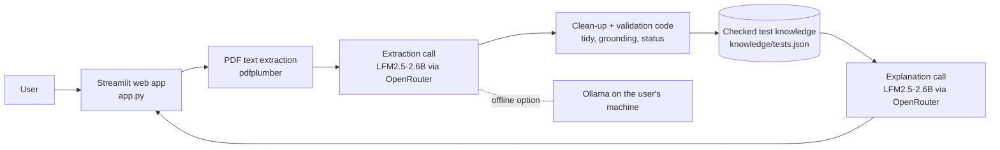
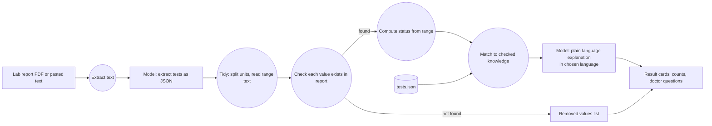
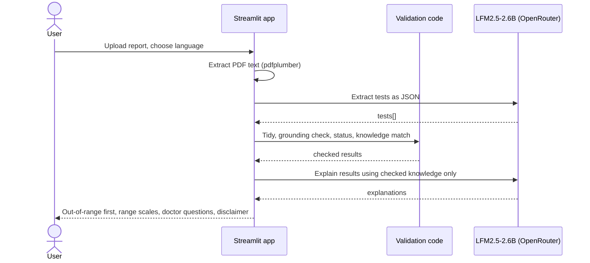

# ReportSamjho · رپورٹ سمجھو

**Understand your lab report in simple English, Urdu or Roman Urdu.** Upload a lab report PDF and see which values are outside the normal range, what each test measures, and what to ask your doctor.

**Live demo:** https://reportsamjho-x4tk2a2kogtirwrzcjxh7b.streamlit.app · **Source:** https://github.com/AR18now/reportsamjho · **License:** MIT

Built for Hacktoberfest Islamabad 2026 · Domain: **Health & Wellness** · Team: Ali Rizwan (solo)

> ReportSamjho explains reports. It does not diagnose and does not replace a doctor.

## Problem

People in Pakistan receive lab reports (CBC, sugar, lipid profile, liver and kidney tests, urine R/E) full of abbreviations like HbA1c, SGPT or TLC. Most patients, and the family members who manage an elderly parent's health, cannot tell which values matter or what they mean. They search online, get confusing or alarming answers, or wait days for a doctor's appointment just to understand the report.

**Target users:** patients and their families, especially people more comfortable in Urdu than in medical English.

## Solution

ReportSamjho reads the report and, for every test:

- shows the value, the normal range printed on the report, and whether it is within, above, or below that range, with a small scale showing where the value sits;
- explains what the test measures and what out-of-range values are generally linked to, in English, Urdu, or Roman Urdu;
- lists questions to take to the doctor about the values that need attention;
- shows a clear "see a doctor soon" note when a value is far outside its range.

**Core features**

- PDF upload, the built-in synthetic sample, or pasted report text
- Values outside the range shown first, grouped and counted
- Explanations in English, Urdu (right-to-left, Nastaliq font), or Roman Urdu
- Runs on a free cloud model (OpenRouter), or fully offline with Ollama so medical data never leaves the device
- Nothing is stored; the report lives only in the browser session

## AI component

| Item | Detail |
|---|---|
| Model | **LFM2.5-2.6B** by Liquid AI, OpenRouter id `liquid/lfm-2.5-2.6b:free` |
| Parameter size | **2.6 billion** (event limit: 8B) |
| Weights / license | Open-weight, [LiquidAI/LFM2.5-2.6B](https://huggingface.co/LiquidAI/LFM2.5-2.6B), LFM Open License v1.0 |
| Runtime / API provider | **OpenRouter** free tier, OpenAI-compatible Chat Completions API, called with the `openai` Python client |
| Offline option | Any Ollama model ≤ 8B via `LLM_PROVIDER=ollama` (default `qwen3:8b`, Apache-2.0). Supported in code; not used for the results below. |
| Settings | Temperature 0, JSON output mode (with automatic fallback if a provider rejects it), 240 s timeout |

**Why this model:** Groq shut down `llama-3.1-8b-instant` on 16 Aug 2026 (our original model) and no longer offers any chat model within 8B. We needed a model that is ≤ 8B, open-weight and free to call from a hosted demo; LFM2.5-2.6B on OpenRouter's free tier was the option that met all three.

**What the model does (two calls per report):**

1. **Extraction.** Reads the raw report text and returns structured JSON for every test: section/panel, test name, value, unit, and reference range. This replaces hand-written parsers, which break on every lab's different layout.
2. **Explanation.** Rewrites a checked knowledge entry for each test into 2–3 calm, plain sentences in the chosen language, tailored to the patient's result.

**Why the AI is essential:** without the model, the app cannot read reports from different labs or explain them in Urdu. Removing it removes the product.

**How we keep a small model honest (original engineering in this repo):**

- **Clean-up of model output** (`tidy_extraction`). Splits units the model glued onto values (`"10.8 g/dL"` → `10.8`) and, when the printed range is a plain pattern (`a - b`, `< x`, `> x`), reads the limits from that text with code instead of trusting the model's numbers. Both rules come from bugs we saw in live runs (see Findings).
- **Grounding check.** Every value the model extracts must appear in the report text. Values that don't are removed and listed under "How we checked these results".
- **Code decides the status, not the model.** Low / normal / high is computed by plain code from the report's own range (`compute_status`).
- **Checked knowledge only.** Explanations are based on `knowledge/tests.json`: 39 common tests written in plain words and checked against MedlinePlus. Tests not in the list show "please ask your doctor" instead of a guess.
- **Panel-aware matching.** `pH` under *Urine R/E* is explained as urine pH; `pH` under any other section (e.g. blood gases) is not explained, because blood pH means something completely different.

## Architecture



## Data flow



No database is used and nothing is stored: the report lives only in the user's session, so no ER diagram applies.

## Sequence



## Setup

**Requirements:** Python 3.10+ and a free OpenRouter API key (openrouter.ai → Keys, no card needed), or Ollama for the offline option.

```bash
git clone https://github.com/AR18now/reportsamjho.git
cd reportsamjho
python -m venv .venv
source .venv/bin/activate        # Windows: .venv\Scripts\activate
pip install -r requirements.txt
cp .env.example .env             # Windows: copy .env.example .env
```

Edit `.env` (never commit it; it is in `.gitignore`):

| Variable | Meaning |
|---|---|
| `LLM_PROVIDER` | `openrouter` (default) or `ollama` |
| `OPENROUTER_API_KEY` | Your key from openrouter.ai/keys |
| `LLM_MODEL` | Optional. Default `liquid/lfm-2.5-2.6b:free` (OpenRouter), `qwen3:8b` (Ollama) |
| `LLM_TIMEOUT` | Optional. Seconds per model request, default 240 |

**Run:**

```bash
streamlit run app.py
```

**Deploying on Streamlit Community Cloud:** point it at this repo, main file `app.py`, Python 3.11, and add `LLM_PROVIDER = "openrouter"` and `OPENROUTER_API_KEY = "..."` under **Settings → Secrets**.

**Minimal usage example:** tick "Use the sample report", choose English, click **Explain my report**. After 1–3 minutes on the free tier you should see 14 results: 7 outside the range (haemoglobin, MCV, cholesterol, HDL, ALT, vitamin D, urine pus cells), urine pH explained as urine pH, and C-Reactive Protein with the "ask your doctor" message.

**Run the tests (no API key needed):**

```bash
pytest -q
```

## Testing and findings

All test data is synthetic (`samples/sample_report.pdf`, made by `scripts/make_sample_report.py`). No real patient data is in this repository.

**Automated tests** (`tests/`, 9 tests, run with `pytest`, no network, all passing):

| Scenario | Input | Expected | Actual | Result |
|---|---|---|---|---|
| Status logic | 10.8 with range 12–16; 236 with "< 200"; "8-10" with 0–5 | low; high; far above | same | ✅ Pass |
| Grounding | Model output containing an invented "Fake Test 99.9" | Row removed | Removed, listed in dropped | ✅ Pass |
| Panel-aware pH | `pH` under Urine R/E vs Arterial Blood Gases vs no panel | Urine explanation; none; none | same | ✅ Pass |
| Same name, different panel | `RBC` under CBC vs Urine R/E | Blood RBC vs urine RBC entry | same | ✅ Pass |
| Unknown test | C-Reactive Protein (not in knowledge list) | No AI explanation, doctor message | same | ✅ Pass |
| Unit glued to value | `"10.8 g/dL"`, unit `g/dL` | Value 10.8, status low | same | ✅ Pass |
| Wrong limit from model | HDL 38, range text "> 40", model gave upper limit 40 | Limit read from text, status low | same | ✅ Pass |
| JSON mode rejected | Provider returns 400 for JSON mode | Retry without it, still parsed | same | ✅ Pass |
| Full flow (fake model) | Sample PDF through `analyze()` | 14 results, 1 dropped, most urgent first | same | ✅ Pass |
| JSON robustness | Reply wrapped in ``` or `<think>` tags | Parsed correctly | same | ✅ Pass |

**Live model tests** (10 Oct 2026, deployed app, `liquid/lfm-2.5-2.6b:free` via OpenRouter, sample report):

| Scenario | Expected | Actual | Result |
|---|---|---|---|
| Sample report, English (before fixes) | 14 tests, 7 out of range | 14 tests read, but **0 out of range**: the model put units inside values (`"10.8 g/dL"`), so no value parsed as a number | ❌ Fail → fixed by `tidy_extraction` |
| Sample report, English (after fix) | 14 tests extracted, 0 dropped, 7 out of range | 14 extracted, 0 dropped, 7 out of range, every status correct; 5 of 13 known tests got AI-written text, the other 8 showed the checked one-line description; took about 3½ minutes | ✅ Pass |
| Sample report, Urdu | Urdu-script explanations, no diagnosis words, correct statuses | Urdu script, 12 of 13 explained, about 1 minute; some wrong word choices (e.g. پتہ دارے for urine) and one stray Hindi letter. **HDL 38 shown as within range**: the model read "> 40" as an upper limit | ❌ Fail → limit bug fixed (range text now read by code); Urdu wording quality remains a limitation |
| Sample report, Roman Urdu (twice) | Roman Urdu explanations | Explanations came back in **English** both times, even after adding an example sentence to the prompt. Statuses correct except one run where Pus Cells "8-10" was shown as "Read on report" | ❌ Fail (model limitation, see below) |
| Pasted partial report text | Only the pasted tests | Not run at the event (time) | ⏭ Not run |

**Known limitations**

- **Small-model quality.** LFM2.5-2.6B does not officially support Urdu. Urdu-script output is readable but has wrong word choices; Roman Urdu requests came back in English in our tests. Explanations sometimes add a phrase that is not in the checked knowledge (e.g. "your immune system is functioning properly").
- **Speed and limits.** The OpenRouter free tier took between 1 and 3½ minutes per report and has daily request limits.
- **Extraction is not perfectly repeatable.** The same report gave slightly different raw extractions across runs; the clean-up and grounding code catch the cases we saw, and unexpected values fall back to "Read on report" rather than a wrong status.
- Scanned or photographed reports have no text layer; users must paste the text for now (OCR is the next feature).
- The knowledge list covers 39 common tests; others show a "please ask your doctor" message.
- The "far from range" note uses a simple rule (≤ half the lower limit, ≥ double the upper limit), not clinical critical values.
- Reference ranges are taken from the report itself; reports without ranges get "No range given".

## Project structure

```
app.py                         Streamlit interface (annotated lab-report design)
.streamlit/config.toml         Light "paper" theme so text is readable in any browser theme
reportsamjho/pipeline.py       Extraction, clean-up, validation, knowledge matching, explanation
knowledge/tests.json           Checked plain-language test explanations (generated)
scripts/build_kb.py            Source of the knowledge list
scripts/make_sample_report.py  Generates the synthetic sample PDF
samples/                       Synthetic report + expected results
tests/                         Offline tests (no key needed)
```

## Open-source and event checklist

| Requirement | Where it is met |
|---|---|
| Open-weight AI is central | Model does extraction and explanation; app cannot work without it (see AI component) |
| Model ≤ 8B, exact name, size, provider and integration disclosed | LFM2.5-2.6B, 2.6B, OpenRouter, `openai` client (AI component table) |
| Meaningful original work | Validation pipeline, clean-up rules, panel-aware knowledge matching, 39-test knowledge base, UI (all in this repo) |
| Public GitHub repository | https://github.com/AR18now/reportsamjho |
| Recognized open-source license | [MIT](LICENSE) |
| Third-party components acknowledged, licenses respected | Acknowledgements below, with licenses |
| Setup, run and test instructions | Setup section |
| No secrets in the repo | `.env` is git-ignored; keys live only in local `.env` / Streamlit Secrets |
| No private data | Only a synthetic sample report |
| Architecture, data-flow and sequence diagrams | Mermaid diagrams above; no database, so no ER diagram |
| Honest testing and limitations | Testing and findings section, including failures |
| Use of AI development tools disclosed | Acknowledgements |

## Team

| Name | Contribution |
|---|---|
| Ali Rizwan | Solo build: idea, pipeline, validation and grounding logic, knowledge list, UI, tests, documentation |

## License

MIT, see [LICENSE](LICENSE).

## Acknowledgements

- **LFM2.5-2.6B** by Liquid AI (LFM Open License v1.0), served free via **OpenRouter**
- **Qwen3-8B** by the Qwen team (Apache-2.0), for the optional offline mode via **Ollama** (MIT)
- **MedlinePlus** (U.S. National Library of Medicine), used to check our plain-language test summaries, which are written in our own words
- **Streamlit** (Apache-2.0), **pdfplumber** (MIT), **OpenAI Python SDK** (Apache-2.0, used only as a client for OpenAI-compatible endpoints), **python-dotenv** (BSD-3-Clause), **ReportLab** (BSD), **pytest** (MIT)
- Fonts via Google Fonts: **IBM Plex Sans / Mono** and **Source Serif 4** and **Noto Nastaliq Urdu** (all SIL Open Font License 1.1)
- AI-assisted development: **Claude Code** (Anthropic) was used while writing and debugging code and documentation; all logic was reviewed and tested by the author. The submitted app itself uses only the open-weight model above.
